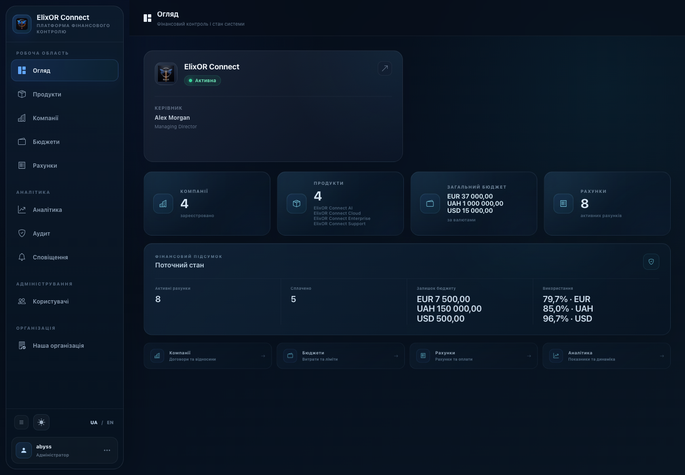
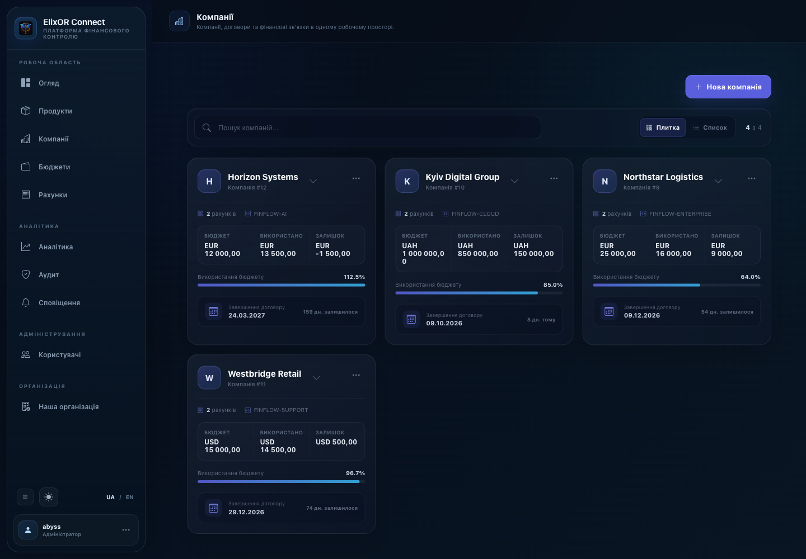
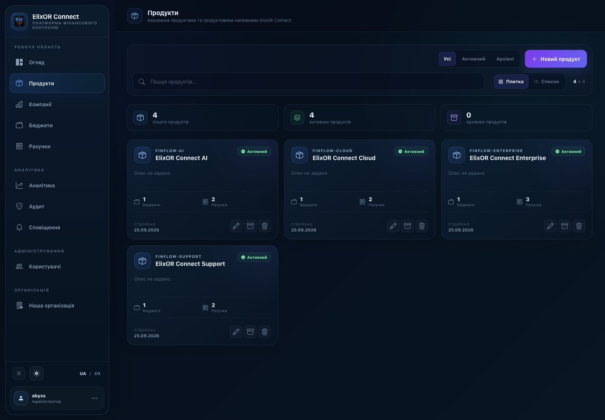
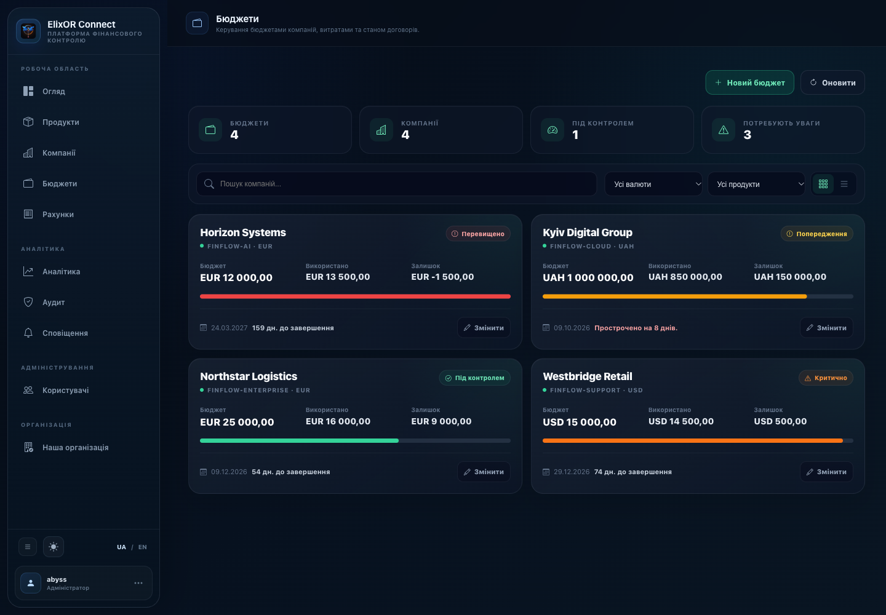
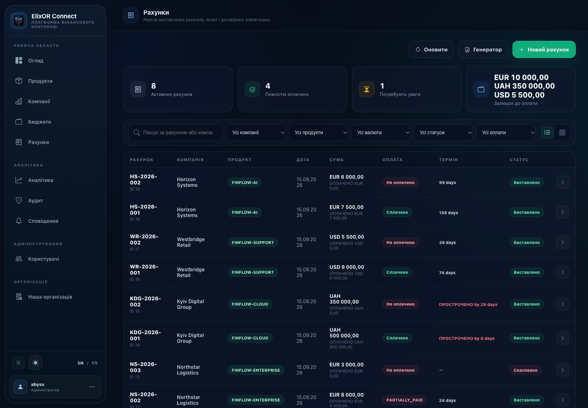
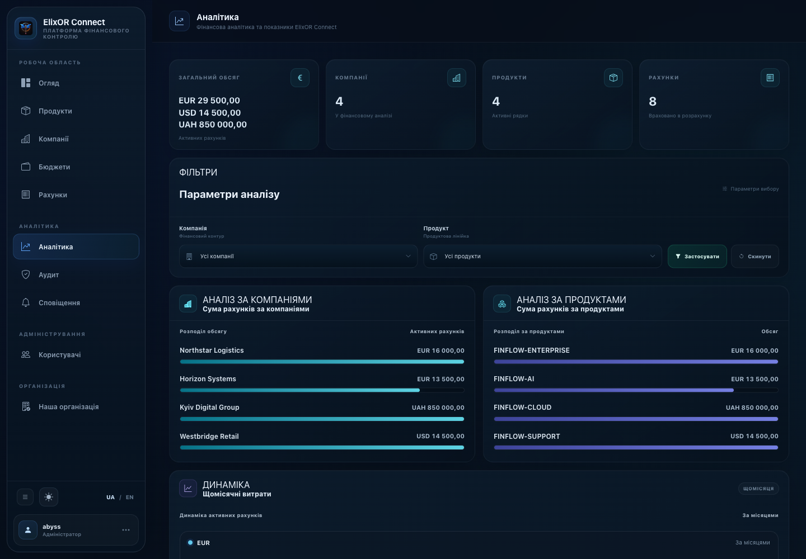
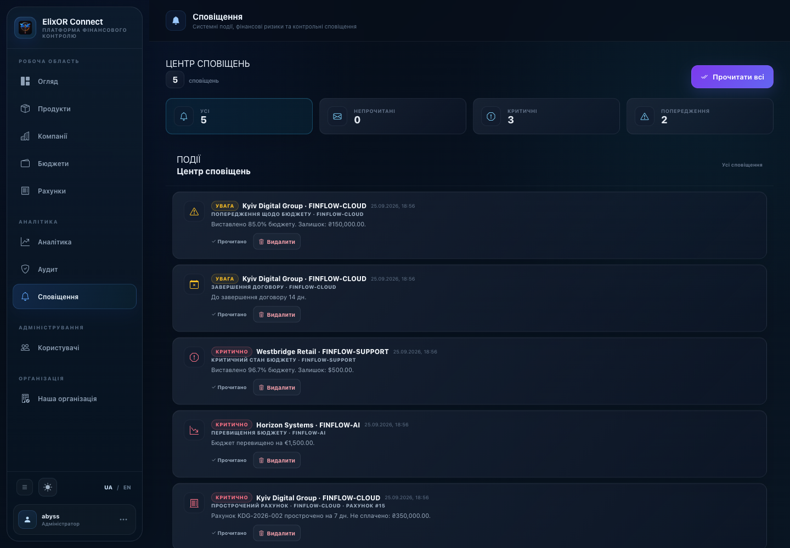
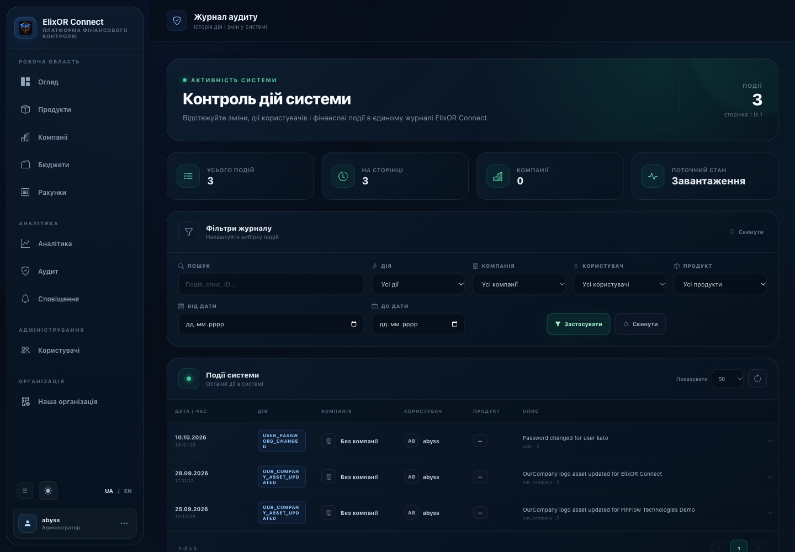
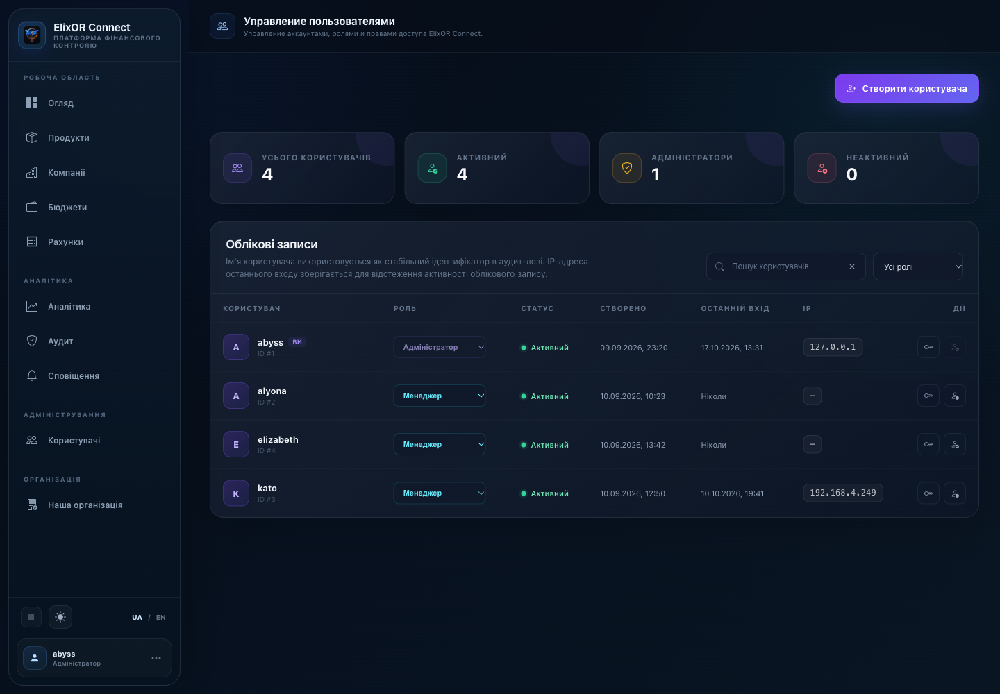
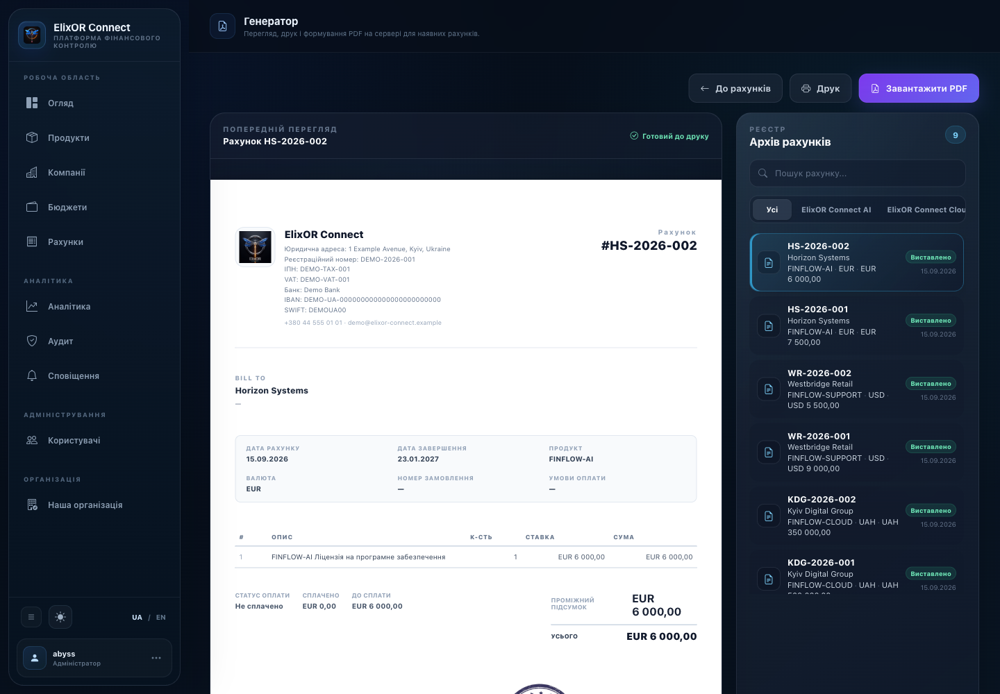

# ElixOR Connect

ElixOR Connect is a Flask web application for managing company finances. It brings together company and product records, budgets, outgoing invoices and payments, document generation, analytics, notifications, and audit history in one authenticated interface.

<p align="center">
  
</p>

The interface supports Ukrainian and English, with Ukrainian as the default language, and includes light and dark themes.

## Features

- **Dashboard** — financial overview with company, budget, invoice, and notification information.
- **Products** — manage products and review product-linked financial information.
- **Companies** — maintain company records and view related financial activity.
- **Budgets** — track budget amounts, spending, remaining amounts, and completion information.
- **Invoices** — create and edit outgoing invoices, track payment and cancellation state, and filter records.
- **Generator** — review the invoice archive and generate invoice PDFs using configured issuer details.
- **Analytics** — review financial indicators with date, company, and product filters.
- **Audit** — inspect recorded actions, affected entities, timestamps, and user attribution.
- **Notifications** — review and manage in-app notifications.
- **Users** — administrator-managed user accounts and roles.
- **Our organization** — configure issuer organization details and document assets such as logos, signatures, and stamps.

The application also has a public landing page and login page. A guest visiting `/` sees the landing page; an authenticated user sees the Dashboard.

## Screenshots

The following screenshots showcase the ElixOR Connect interface using demonstration data.

<table>
  <tr>
    <td width="50%">
      <strong>Dashboard</strong><br>
      
    </td>
    <td width="50%">
      <strong>Companies</strong><br>
      
    </td>
  </tr>
  <tr>
    <td width="50%">
      <strong>Products</strong><br>
      
    </td>
    <td width="50%">
      <strong>Budgets</strong><br>
      
    </td>
  </tr>
  <tr>
    <td width="50%">
      <strong>Invoices</strong><br>
      
    </td>
    <td width="50%">
      <strong>Analytics</strong><br>
      
    </td>
  </tr>
  <tr>
    <td width="50%">
      <strong>Notifications</strong><br>
      
    </td>
    <td width="50%">
      <strong>Audit Log</strong><br>
      
    </td>
  </tr>
  <tr>
    <td width="50%">
      <strong>Users &amp; Roles</strong><br>
      
    </td>
    <td width="50%">
      <strong>Invoice Generator</strong><br>
      
    </td>
  </tr>
</table>

All screenshots are captured from the local application using demonstration data. No production database or production application was modified to create them.

## Technology stack

- **Backend:** Python, Flask, Flask-SQLAlchemy, SQLAlchemy
- **Database and schema migrations:** PostgreSQL, psycopg, Alembic
- **Templates:** Jinja2
- **Frontend:** HTML, page-specific CSS, JavaScript, and a checked-in Tailwind-generated stylesheet used by the Dashboard
- **Documents:** ReportLab for invoice PDF generation; Pillow for image handling
- **Production serving:** Gunicorn behind the deployment's web server
- **Automation:** GitHub Actions for CI checks and a manually dispatched deployment workflow

The dependency versions used by the application are pinned in [`requirements.txt`](requirements.txt). Tailwind CLI and its build version are not declared in a package manifest, so this README does not prescribe a Tailwind build command.

## Architecture and project structure

The Flask application in `app.py` defines routes, authentication and authorization checks, SQLAlchemy models, and application behavior. Jinja templates render the public and authenticated pages. Static files contain shared and page-specific styles and JavaScript. Alembic migration scripts live separately from the application code.

```text
.
├── app.py                         # Flask app, routes, models, and application logic
├── requirements.txt               # Pinned Python dependencies
├── dev.sh                         # Local development helper
├── alembic.ini                    # Alembic configuration
├── alembic/
│   ├── env.py                      # Loads application metadata and DATABASE_URL
│   └── versions/                   # Schema migration revisions
├── templates/                     # Jinja templates for landing and application pages
├── static/
│   ├── css/                        # Shared and page-specific stylesheets
│   ├── js/                         # Shared and page-specific scripts
│   └── uploads/                    # Organization and company document assets
├── ops/
│   ├── elixor-deploy               # Restricted deployment helper
│   └── tests/                      # Deployment-helper tests
├── .github/workflows/              # CI and manual deployment workflows
└── docs/screenshots/               # Intended location for approved UI screenshots
```

The authenticated UI is composed from shared styles and page-specific stylesheets; the public landing page has its own styling. The compiled `static/css/tailwind.css` is included by the Dashboard template. Most other pages also use their own CSS files.

## Requirements and local development

The checked-in CI workflow uses **Python 3.13**. Local development instructions below follow the repository's `dev.sh` helper and use PostgreSQL. SQLite is not documented as a verified development workflow.

You will need Python, PostgreSQL, and the PostgreSQL command-line utilities (`pg_isready`, `psql`, and, when creating the local database, `createdb`). From the repository root:

```bash
python3 -m venv .venv
.venv/bin/python -m pip install -r requirements.txt
```

Start your local PostgreSQL service and create the local database if it does not already exist:

```bash
createdb elixor_local
```

The helper creates a local `.env.local` with a generated `SECRET_KEY` on first run. It requires `.env.local` to be ignored by Git, sets `DATABASE_URL` to the local PostgreSQL database, checks connectivity, and starts Flask in debug mode. For a first-time setup, run it once to create the local secret, then stop the server with Ctrl+C so you can apply migrations before using the application:

```bash
./dev.sh
```

The helper expects the local database to exist and does not create or migrate its schema. To apply the current Alembic migrations to this local database, first load the local secret and database URL into the shell, then run:

```bash
set -a
. ./.env.local
set +a
export DATABASE_URL="postgresql+psycopg:///elixor_local"
.venv/bin/python -m alembic upgrade head
```

After the migration command completes, run `./dev.sh` and open `http://127.0.0.1:5000`. The helper listens on `127.0.0.1:5000`; it also prints the `/health` endpoint. Do not point local development commands at a production database.

## Environment and configuration

The application requires these environment variables:

| Variable | Purpose |
| --- | --- |
| `SECRET_KEY` | Flask session signing key. The application refuses to start when it is missing. |
| `DATABASE_URL` | SQLAlchemy database connection URL. PostgreSQL URLs are normalized to use the psycopg driver. |

`PORT` is optional and defaults to `5000` when the application is started directly with `python app.py`. The `dev.sh` helper explicitly uses port `5000`.

Use locally generated values and a PostgreSQL URL appropriate for your own environment. Never commit `.env.local`, credentials, database dumps, or production configuration. Do not copy real environment values into documentation or issue reports.

## PostgreSQL and Alembic

PostgreSQL is used by the local development helper and production deployment. Schema changes are managed with Alembic directly; Flask-Migrate is not used. The repository contains one current migration head. The CI workflow validates the migration graph with:

```bash
python -m alembic heads
```

With `SECRET_KEY` and `DATABASE_URL` set for the intended database, inspect or apply migrations using:

```bash
.venv/bin/python -m alembic current
.venv/bin/python -m alembic heads
.venv/bin/python -m alembic upgrade head
```

Applying migrations changes the selected database schema. Confirm the target database and take an appropriate backup before applying schema changes outside a disposable local environment. The deployment helper does not run Alembic migrations automatically.

## Testing and CI coverage

The GitHub Actions CI workflow runs on pushes to branches and pull requests targeting `main`. It installs `requirements.txt` using Python 3.13 and performs these checks:

- `python -m unittest discover -s ops/tests -v` — tests for deployment rollback safeguards;
- shell syntax validation and ShellCheck for `ops/elixor-deploy`;
- Python bytecode compilation for `app.py` and `alembic/`;
- `pip check` for installed dependency consistency;
- `python -m alembic heads` for migration history validation.

These checks do not constitute browser, UI, end-to-end, or comprehensive application integration tests. Changes to application behavior should also receive appropriate local functional and visual checks. A useful whitespace/diff check is:

```bash
git diff --check
```

## CI/CD and deployment

The CI workflow and deployment workflow are separate. Deployment is **manually dispatched** from GitHub Actions and is restricted by its workflow to the `main` branch and a configured self-hosted Linux runner. It is not triggered automatically by every push.

The workflow invokes the repository's restricted `ops/elixor-deploy` helper. The helper includes deployment safeguards such as backups, health checks, service verification, and rollback handling. The script does not apply Alembic migrations; database migration planning and execution must be handled separately by the authorized operator.

The production stack uses PostgreSQL and Gunicorn behind Nginx. Production-specific hostnames, paths, service details, credentials, and operational commands are intentionally omitted from this public project documentation. Follow the approved operational runbook for access to those procedures.

## Security

The application implements session-based authentication, password hashing, role checks, CSRF validation for state-changing requests, and audit logging. The configured session cookies use `HttpOnly`, `SameSite=Lax`, and `Secure` attributes. User-management routes are restricted to administrators; financial write operations are role-protected. API endpoints return API-appropriate authorization errors where applicable.

Operational guidance:

- Set a strong, private `SECRET_KEY` and keep it outside version control.
- Use a protected PostgreSQL database and restrict access to application credentials.
- Do not commit `.env` files, private keys, database dumps, or uploaded files containing sensitive information.
- Review database targets and backups before running schema or data maintenance operations.
- Use representative, anonymized data in screenshots, examples, and bug reports.

## Roadmap

This roadmap distinguishes current functionality from possible future work. It does not make delivery-date commitments.

### Implemented

- Authenticated financial application with Dashboard, Products, Companies, Budgets, Invoices, Generator, Analytics, Audit, Notifications, Users, and Our organization pages.
- Outgoing invoice creation and editing, payment tracking, cancellation state, and PDF generation.
- Per-record currency fields for budgets and invoices.
- Ukrainian and English interface localization, with Ukrainian as the default language, plus light and dark themes.
- Alembic schema migrations, CI checks, and a manually dispatched deployment workflow with operational safeguards.

### Potential future work

- Contact, deal, and interaction-history management around the existing Companies functionality.
- Exchange-rate data and converted or consolidated reporting across currencies.
- Incoming invoices, payables/receivables, and broader incoming/outgoing financial workflows.
- Forecasting and plan-versus-actual reporting.
- External accounting integrations and synchronization, including systems such as 1C or M.E.Doc, subject to requirements and availability.
- Docker/Compose packaging and a documented container-based installation/update workflow.
- A mobile client after the API contract and authentication requirements are defined.
- Additional application-level integration and browser-based visual test coverage.

## Contributing

Before submitting a change:

1. Keep changes focused and preserve existing application behavior unless the change requires otherwise.
2. Run the relevant checks described in [Testing and CI coverage](#testing-and-ci-coverage).
3. Review `git diff` and run `git diff --check`.
4. Do not include secrets, production data, or unapproved screenshots.
5. Document database schema changes with an Alembic migration and coordinate their application separately from deployment.

## License

This project is distributed under the license in [`LICENSE`](LICENSE). This README does not alter or re-declare the license terms.
